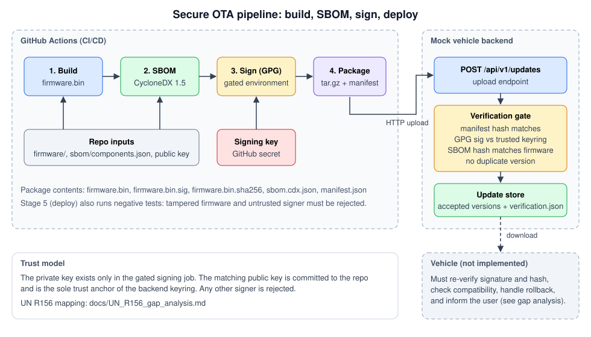

# Secure Vehicle Update System with SBOM Pipeline
[](https://github.com/d0ok/secure-ota-pipeline/actions/workflows/pipeline.yml)

A demonstration CI/CD pipeline for over-the-air (OTA) vehicle software updates:

**build firmware → generate CycloneDX SBOM → sign with GPG → package → deploy to a mock vehicle backend that verifies everything before accepting.**

A gap analysis maps the pipeline to UN R156 (software update management): [docs/UN_R156_gap_analysis.md](docs/UN_R156_gap_analysis.md).



## What it demonstrates

| Stage | Implementation |
|---|---|
| Build | `firmware/` C program compiled with version and build id injected |
| SBOM | CycloneDX 1.5 JSON via `scripts/generate_sbom.sh`: linked libraries detected from the real binary and mapped to distro packages, plus hand-declared vendored code; validated against the official schema in CI |
| Vulnerability gate | Grype scans the SBOM before signing; a Critical or known-exploited finding blocks the release; a canary self-test proves the scanner can still detect something |
| Signing | Detached, armored GPG signature, performed in a protected GitHub environment |
| Package | `tar.gz` with firmware, signature, SHA-256, SBOM, manifest |
| Mock backend | Flask service (`backend/app.py`) that checks manifest hash, GPG signature against a trusted keyring, SBOM-to-firmware hash binding, and rejects duplicate versions |
| Negative tests | `scripts/tamper_test.sh`: modified firmware and untrusted signer must be rejected |

## Run it locally

Requirements: `gcc`, `make`, `gpg`, `python3`, `curl`.

```bash
pip install -r backend/requirements.txt "cyclonedx-python-lib[json-validation]"
scripts/local_e2e.sh
```

This uses an ephemeral GPG key and runs the same scripts as CI. It ends with `ALL CHECKS PASSED` when build, SBOM, signing, deployment, tamper rejection and replay rejection all behave.

## Set up the GitHub pipeline

1. Generate the release key once, on a trusted machine:
   ```bash
   scripts/gen_release_key.sh
   ```
   Commit `keys/release-signing.pub.asc`. The private key is only printed to your terminal.
2. In the repo settings:
   - Create an environment named `firmware-signing`, with required reviewers.
   - Add environment secrets `GPG_PRIVATE_KEY` and `GPG_PASSPHRASE`.
   - Add the variable `GPG_KEY_ID` (the fingerprint printed by the script).
3. Push to `main`. The workflow in `.github/workflows/pipeline.yml` runs build, sbom, vuln-scan, sign (waits for approval), then deploy-mock-backend.

## Vulnerability scanning

The `vuln-scan` job runs before `sign`, so a release that fails the policy never receives a signature.

1. **Install.** Grype is downloaded at the version in `.grype-version` and its checksum is verified.
2. **Self-test.** `tests/canary.cdx.json` lists a deliberately old glibc. The scanner must report findings for it, otherwise the run fails. This guards against a scanner that silently matches nothing (this happened during development; see section 4 of the gap analysis).
3. **Scan.** The release SBOM is scanned and the JSON report is kept as the `vulnerability-report` artifact.
4. **Policy** (`scripts/vuln_gate.py`). The release is blocked on any Critical finding or any finding in CISA's Known Exploited Vulnerabilities catalogue. Lower severities are reported but do not block.

Run it locally:

```bash
make -C firmware OUT=$PWD/build
scripts/generate_sbom.sh build/firmware.bin 1.0.0 build/sbom.cdx.json
grype sbom:build/sbom.cdx.json -o json > build/report.json
python3 scripts/vuln_gate.py build/report.json --fail-on Critical --fail-on-kev
```

Notes:

- To change the policy, edit the arguments of the `Apply release policy` step in the workflow (`--fail-on` accepts Negligible, Low, Medium, High, Critical).
- To update Grype, install the new version, run `grype version | awk '/^Version:/{print "v"$2}' > .grype-version`, and commit.
- The policy uses the distro's own severity rating, which can differ from NVD's.
- There is no exception or VEX mechanism yet. If a finding blocks a release, the options are to update the affected package or to change the policy. Documenting why a finding does not apply is listed as future work in the gap analysis.
- Only detected packages and declared components with matchable identifiers are screened. The hand-declared vendored driver uses a generic identifier and is not.

## Layout

```
firmware/        mock ECU firmware and Makefile
sbom/            hand-declared components (detected ones come from the build)
scripts/         build, sign, verify, package, deploy, scan policy, tests
tests/           scanner canary SBOM
backend/         mock vehicle backend (Flask)
keys/            public signing key (you add this)
docs/            gap analysis and architecture diagram
.github/         workflow
```

## Limitations

This is a teaching and portfolio project, not a production OTA system. The backend has no TLS, device identity or real persistence; the vehicle side is not implemented; vendored or statically linked code must be declared by hand in the SBOM; vulnerabilities are checked at build time only, not monitored after release; keys are software keys. See the gap analysis for the full list, and do not read it as evidence of R156 compliance.
